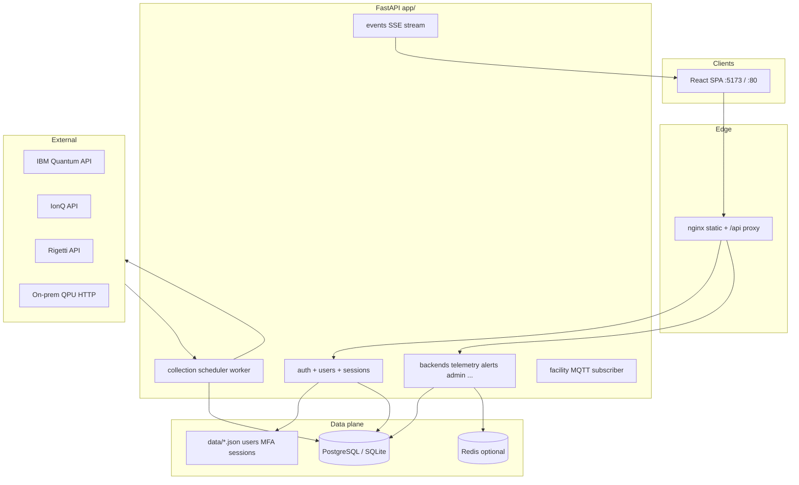
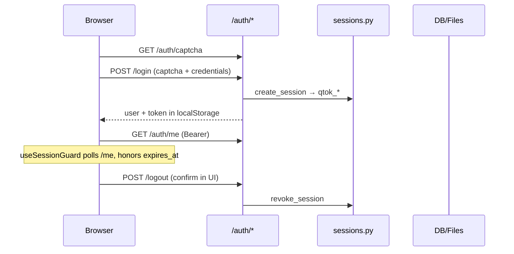

# Q-TeleScope platform status, architecture, and workflows

**Evidence date:** 2026-11-09  
**Scope:** Primary product surface — `frontend/` + `app/` (FastAPI). Excludes sibling apps `apps/govern`, `apps/studio`, `quantum-resource-portal` unless noted as shared API.

**Production verdict:** **Not production-ready for untrusted internet exposure.** Suitable for **lab, demo, and controlled VM/UAT** when configured per [`.env.production.example`](../.env.production.example). Authoritative gate: [docs/QA/PRODUCTION_READINESS_REPORT.md](QA/PRODUCTION_READINESS_REPORT.md).

---

## 1. Executive summary

| Dimension | Status | Notes |
| --- | --- | --- |
| **Observe UI (React)** | Operational | ~28 routed `/app/*` screens; RBAC-gated nav; product tour; confirm dialogs on sign-out and critical admin actions (2026-11-09) |
| **API (FastAPI)** | Operational | `app/main.py`, prefix `/api/v1`; optional global auth middleware |
| **Primary database** | PostgreSQL recommended | SQLAlchemy ORM; Alembic migrations; SQLite for lightweight tests |
| **Redis** | Optional | Speeds alert/health reads + auth rate limits; **app runs without Redis** (Postgres-only fallback) |
| **Live providers** | Config-dependent | IBM / IonQ / Rigetti / on-prem adapters; mock/demo when `ENABLE_MOCK_DATA=true` or keys empty |
| **Automated tests** | Strong API coverage | **190 passed / 2 skipped** (`USE_ALEMBIC=false`, 2026-11-09, ~5 min); TeleScope browser E2E still sparse |
| **Identity** | Bearer sessions + captcha + MFA + LDAP bind | Sessions in `app/core/sessions.py`; client auto sign-out on TTL/401 |

---

## 2. System architecture



**Canonical backend entry:** repository root `app/main.py` (not the legacy `backend/` partial copy).

---

## 3. Runtime setup options

### 3.1 Docker Compose (reference)

| Service | Image / build | Port | Role |
| --- | --- | --- | --- |
| `backend` | `deployment/Dockerfile.backend` | 8000 | API + scheduler + collectors |
| `frontend` | `deployment/Dockerfile.frontend` | 80 | Built SPA |
| `db` | `postgres:16` (profile `postgres`) | 5432 | Primary DB |
| `redis` | `redis:7-alpine` | 6379 | Optional cache / rate limit |

See `docker-compose.yml`, `docker-compose.dev.yml`, and [DATABASE_AND_CACHE.md](DATABASE_AND_CACHE.md).

### 3.2 Host dev (no Docker)

```bash
export PATH="$HOME/miniforge3/bin:$PATH"
./scripts/setup-local-infra.sh    # once: Postgres + Redis
./scripts/dev-up.sh               # API :8000
cd frontend && npm run dev        # :5173, proxies /api/v1
```

### 3.3 Production-oriented env (summary)

| Variable | Purpose |
| --- | --- |
| `ENVIRONMENT=production`, `QRE_PROFILE=production` | Enables startup security warnings |
| `REQUIRE_API_AUTH=true` | Middleware requires valid `qtok_*` on non-public routes |
| `ENFORCE_RBAC=true` | Permission checks on protected API handlers |
| `DATABASE_URL=postgresql+...` | Production persistence |
| `REDIS_URL=redis://...` | Optional; `CACHE_ENABLED=true` |
| `ENABLE_MOCK_DATA=false` | No synthetic fleet unless adapters fail openly |
| `PERSIST_API_SESSIONS=true` | Session file under `data/` |
| `SESSION_TTL_SECONDS` | Server session lifetime (default 24h) |
| `CORS_ORIGINS` | Exact browser origin(s) |
| Provider keys | `IBM_QUANTUM_TOKEN`, `IONQ_API_KEY`, `RIGETTI_API_KEY`, `ONPREM_QPU_URL` |

Full template: [`.env.production.example`](../.env.production.example).

### 3.4 VM deploy (typical)

```bash
cd ~/QTeleScope
git fetch origin
git reset --hard origin/main
chmod +x scripts/vm-demo-restart.sh
./scripts/vm-demo-restart.sh
```

Hard-refresh the browser after frontend asset updates.

---

## 4. Frontend — navigation model and pages

**Router:** React Router paths in [`frontend/src/appNav.js`](../frontend/src/appNav.js); shell state in [`frontend/src/App.jsx`](../frontend/src/App.jsx).  
**Auth gate:** `localStorage.quantum_user` (Bearer token + role). Invalid/expired sessions clear client state and return to login (`useSessionGuard`, 2026-11-09).  
**Sidebar groups:** Observe → Overview, Operate · Analyze → Backends, Telemetry · Execute → Jobs, Queues · Record → Alerts, Incidents, Reports, Timeline · Configure → Integrations, Collectors, Rules, Users (RBAC).

### 4.1 Public routes

| Path | Page | What the user sees / does |
| --- | --- | --- |
| `/` | Landing | Product entry; link to login |
| `/login` | LoginPage | Username/password, **image captcha**, optional MFA step |
| `/register` | RegisterPage | Self-registration (when enabled) with captcha |
| `/forgot-password` | ForgotPasswordPage | Reset token request |
| `/reset-password` | ResetPasswordPage | Set new password from token |

### 4.2 Protected `/app/*` routes (page-by-page)

| Path | Component | Primary content & actions |
| --- | --- | --- |
| `/app/overview` | **DashboardHome** | Shift KPI strip (alerts, incidents, jobs, stale cal); qubit mix + queue charts; fleet health table; alert severity breakdown; platform KPIs; customizable drag panels; links into health, queues, calibration |
| `/app/operate` | **OperationsCentre** | Four-lane operator queue (ack / investigate / remediate / info); “Next up” priority card; per-lane scrollable work items; links to backends, incidents, collectors |
| `/app/platform/health` | **PlatformHealth** | DB reachability, collector health, telemetry store age, scheduler mode, SSE status; provider adapter cards; DLQ / circuit breaker hints |
| `/app/investigate/timeline` | **OpsTimeline** | Unified timeline of alerts, incidents, collector and platform events; filters and drill-down links |
| `/app/backends/inventory` | **BackendInventory** | Fleet summary (online, alerts, stale); modality/provider chips; sortable table; register-backend wizard (admin); row → backend workspace |
| `/app/backends/details/:id[/:tab]` | **BackendDetails** | Tabs: **overview**, **qubits**, **calibration**, **connectivity**, **execution**, **alerts** — per-backend telemetry, health vector slices, jobs, active alerts |
| `/app/telemetry/live` | **LiveTelemetry** | SSE-driven ~5s refresh; KPI cards; refresh log; charts (ops mix, T1 by modality, cadence / staleness) |
| `/app/telemetry/calibration` | **CalibrationStatus** | Freshness buckets per backend; stale highlights |
| `/app/telemetry/drift` | **DriftAnalysis** | Rolling stats and % change on T1/T2/readout |
| `/app/telemetry/trends` | **HistoricalTrends** | Longer-window trend charts |
| `/app/telemetry/topology` | **TopologyExplorer** | Graph / side panel for qubit selection |
| `/app/telemetry/cal-timeline` | **CalibrationTimeline** | Calibration events over time |
| `/app/telemetry/compare` | **BackendComparison** | Cross-backend metric comparison |
| `/app/telemetry/anomalies` | **AnomalyMonitor** | Anomaly flags from stored series |
| `/app/telemetry/replay` | **TemporalReplay** | Time-window replay of telemetry |
| `/app/telemetry/metrics` | **MetricsCoverage** | Registry vs adapter capability coverage |
| `/app/execution/jobs` | **JobMonitoring** | Job KPIs; status filters; sortable grid; failure reason breakdown |
| `/app/execution/queues` | **QueueMonitoring** | Pending/running per backend; queue pressure |
| `/app/resources/health` | **ResourceHealth** | Explainable health scores; GREEN/YELLOW/RED routing; per-qubit factors |
| `/app/resources/environment` | **EnvironmentPage** | Facility / deployment context fields |
| `/app/resources/capabilities` | **DeviceCapabilities** | QDMI-style capability sheets per backend |
| `/app/alerts` | **AlertsEvents** | KPI row; severity matrix; backend ranking; **grouped** alert list (backend+rule); filters; table/grid/calendar layouts; ack/resolve (permissioned) |
| `/app/alerts/incidents` | **AlertsEvents** | Open incidents grid/table/calendar; promote from alerts |
| `/app/alerts/detail/:id` | **AlertDetailPage** | Threshold context, timeline, comments/discussion modal, investigation deep links |
| `/app/alerts/incidents/:id` | **IncidentDetailPage** | Incident timeline, related alerts (paginated), assignment, comments |
| `/app/reports` | **ReportsPage** | HTML/PDF/CSV exports; evidence snapshot create/import; provenance hashes |
| `/app/settings` | **UserSettings** | Profile, password, MFA enroll, **active sessions** (revoke with confirm), notification prefs, theme/density/landing |
| `/app/admin/integrations` | **AdministrationPage** | Provider credentials, live verification, auto-discovery, LDAP status panel |
| `/app/admin/collectors` | **AdministrationPage** | Schedules, manual collection, DLQ, MQTT note |
| `/app/admin/rules` | **AdministrationPage** | Alert rule CRUD, enable/disable |
| `/app/admin/users` | **AdministrationPage** | User list, role assignment |
| `/app/onboarding` | **OnboardingFlow** | First-run platform setup wizard (skips fake discovery without API keys) |

**Cross-cutting UI:** Quick-action dock (tour, shortcuts), product tour (`frontend/src/lib/consoleTour.js`), toast notifications, chart `?` help tooltips, RBAC “Access restricted” cards.

---

## 5. Backend — API domains (`/api/v1`)

Routers registered in [`app/main.py`](../app/main.py):

| Domain | Router module | Typical consumer pages |
| --- | --- | --- |
| **Auth & users** | `auth`, `users` | Login, settings, admin users |
| **Fleet** | `backends`, `qubits`, `topology`, `device_capabilities` | Inventory, backend workspace, topology |
| **Telemetry** | `calibration`, `drift`, `queues`, `jobs`, `health`, `metrics` | All telemetry + execution + resource health |
| **Operations** | `operations`, `events` (SSE) | Overview, operate, live telemetry |
| **Alerts** | `alerts`, `incidents` | Alerts/incidents workspaces |
| **Platform** | `admin`, `infra`, `environment` | Platform health, admin |
| **Evidence** | `reports`, `evidence` | Reports page |
| **Analytics** | `anomalies`, `replay`, `research`, `federated` | Specialized analyze views |
| **Build / govern (API)** | `development/*`, `governance/*` | Used by Q-Forge/QRP surfaces; tables in DB |

Health endpoints: `GET /healthz`, `GET /readyz` (root, not under `/api/v1`).

**Client SDK:** [`frontend/src/services/api.js`](../frontend/src/services/api.js) (~140+ methods).

---

## 6. Database schema

### 6.1 Core telemetry & ops (`app/models/entities.py`)

| Table | Purpose |
| --- | --- |
| `providers` | Vendor adapter registry |
| `backends` | QPU/simulator catalog |
| `qubits`, `gates`, `connectivity_edges` | Static topology |
| `backend_telemetry`, `qubit_telemetry`, `gate_telemetry` | Time-series samples |
| `calibration_snapshots` | Freshness and calibration metadata |
| `job_records` | Execution history |
| `alerts`, `incidents`, `incident_alerts` | Alerting and correlation |
| `evidence_snapshots` | Audit/export packages |
| `collection_schedules` | Per-category collector intervals |
| `alert_rules` | Threshold rules evaluated by alert engine |
| `user_accounts` | Registered users (when not file-only) |
| `audit_events` | Security/ops audit trail |

### 6.2 Build & governance extensions (`app/models/development.py`)

Includes `dev_projects`, `circuit_versions`, `simulation_jobs`, `compilation_runs`, `approval_records`, `meter_samples`, `virtual_resource_pools`, `inventory_assets`, etc. — supporting QRE programme APIs even when the TeleScope UI does not expose every workflow.

### 6.3 Migrations

Alembic revisions under `alembic/versions/` (initial `20261031_0001` + governance/dev expansions). Set `USE_ALEMBIC=true` in production; tests often use `USE_ALEMBIC=false` with in-memory SQLite.

### 6.4 File-backed stores (`data/`)

| File / pattern | Purpose |
| --- | --- |
| `users.json` | Local user registry |
| `user_mfa.json` | TOTP secrets |
| `api_sessions.json` | Optional persisted API sessions (`PERSIST_API_SESSIONS`) |
| Provider credential blobs | Encrypted/stored per admin configuration |

---

## 7. Redis and caching

| Concern | Behavior without Redis | With `REDIS_URL` + `CACHE_ENABLED=true` |
| --- | --- | --- |
| Alert summary | Computed from Postgres each request | Cached ~8s (`qtelescope:alerts:summary`) |
| Health vector hot paths | Postgres reads | Cached ~10s (`qtelescope:health:vector`) |
| Auth rate limit | In-memory buckets | Redis sliding window (`app/core/rate_limit.py`) |
| Failure mode | Transparent fallback | Log warning; continue on Postgres |

Implementation: [`app/core/cache.py`](../app/core/cache.py). See [DATABASE_AND_CACHE.md](DATABASE_AND_CACHE.md).

---

## 8. End-to-end workflows

### 8.1 Sign-in and session



- **LDAP:** optional bind after local user miss (`LDAP_URL`, `LDAP_USER_DN`) — directory auth, not SSO.
- **MFA:** TOTP when enrolled / required; pending step in login flow.
- **Client expiry:** Any API **401** (except public auth routes) clears storage and shows login; post-login can restore safe `/app/*` redirect.

### 8.2 Telemetry ingestion

1. **Startup:** `HardwareDiscoveryEngine.run_auto_discovery` seeds/updates catalog when mock or credentials allow.  
2. **Scheduler:** `collection_scheduler_loop` runs due categories from `collection_schedules` (`COLLECTION_SCHEDULER_ENABLED`).  
3. **Collector:** `TelemetryCollector.run_full_collection_cycle` calls provider adapters → normalizers → SQLAlchemy persist.  
4. **Adapters:** IBM, IonQ, Rigetti, on-prem, truth/stub paths in `app/providers/` — honesty rules: no fake “live” without data.  
5. **Downstream:** Health engine scores qubits; alert engine evaluates `alert_rules`; operations centre aggregates queues.

### 8.3 Alert → incident → operator

1. Rule evaluation creates **ACTIVE** `alerts` rows.  
2. Escalation/grouping creates **incidents** linking multiple alerts (same backend + rule pattern).  
3. Operator opens **Operate** or **Alerts** → ack / investigate / resolve (RBAC).  
4. Comments stored via alert/incident comment APIs; discussion modal in UI.  
5. Calendar views group by backend+rule (not raw duplicate rows).

### 8.4 Live dashboard stream

- `GET /events/stream` (SSE) pushes aggregate platform ticks (~5s).  
- **LiveTelemetry** subscribes; shows active alerts, queue depth, modality T1 snapshot, tick gap diagnostics.

### 8.5 Reports and evidence

- Reports API generates CSV/HTML/PDF snapshots.  
- Evidence API packages SHA-256 manifests for audit import/export on **Reports** page.

---

## 9. Security & RBAC snapshot

| Control | Dev default | Production target |
| --- | --- | --- |
| API auth middleware | Often off in lab | `REQUIRE_API_AUTH=true` |
| RBAC enforcement | Optional | `ENFORCE_RBAC=true` |
| Bootstrap passwords | `quantum2026` demo | `BLOCK_DEFAULT_BOOTSTRAP_CREDENTIALS=true` |
| CORS | Permissive in dev | Explicit `CORS_ORIGINS` |
| Session storage | In-memory / optional file | `PERSIST_API_SESSIONS` + TTL |

Role ↔ permission detail: [RBAC_AND_IDENTITY.md](RBAC_AND_IDENTITY.md), `frontend/src/lib/permissions.js`, `app/core/permissions.py`.

---

## 10. What is *not* in this repo surface

| Item | Note |
| --- | --- |
| QRP Govern UI | `apps/govern/` separate SPA |
| Q-Forge Studio UI | `apps/studio/` separate SPA |
| Full browser E2E for TeleScope | Listed in QA matrix; not fully automated |
| Email password reset | Token API exists; SMTP integration environment-specific |
| TimescaleDB hypertables | Documented as optional future; current path is Postgres indexes |

---

## 11. Quality evidence & open gaps

| Artifact | Location |
| --- | --- |
| Route inventory | [QA/APP_INVENTORY.md](QA/APP_INVENTORY.md) |
| Production gate | [QA/PRODUCTION_READINESS_REPORT.md](QA/PRODUCTION_READINESS_REPORT.md) |
| Defect register | [QA/DEFECT_REGISTER.md](QA/DEFECT_REGISTER.md) |
| API test matrix | [QA/API_TEST_MATRIX.md](QA/API_TEST_MATRIX.md) |
| RBAC matrix | [QA/RBAC_MATRIX.md](QA/RBAC_MATRIX.md) |

**Re-verify tests locally:**

```bash
cd /path/to/QTeleScope
USE_ALEMBIC=false PYTHONPATH=. pytest tests/ -q --ignore=tests/e2e
```

---

## 12. Document maintenance

Update this file when:

- New `/app/*` routes or admin sections ship  
- Schema migrations add tables material to TeleScope UX  
- Production gate criteria change in `PRODUCTION_READINESS_REPORT.md`  
- Session/auth or cache behavior changes  

**Related:** [README.md](../README.md), [SECURITY.md](SECURITY.md), [DATABASE.md](DATABASE.md), [DEVICE_CAPABILITIES.md](DEVICE_CAPABILITIES.md).
