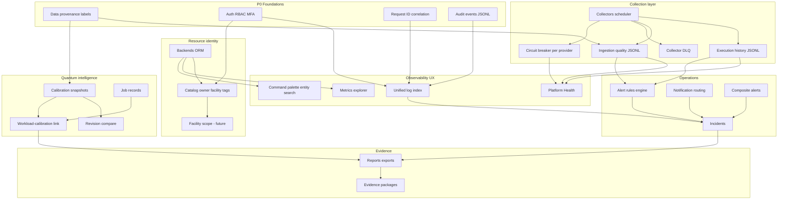

# Enterprise implementation dependency graph

**Companion:** [ENTERPRISE_IMPLEMENTATION_BACKLOG.md](ENTERPRISE_IMPLEMENTATION_BACKLOG.md)

Build order: top → bottom (foundations first).

## Dependency rules (text)

| Feature | Depends on |
| --- | --- |
| Unified Logs Explorer | Structured logging, request ID, retention policy, RBAC |
| Alert → logs | Log index by backend/time/request_id; alert timestamps |
| 30d execution API | Durable store + retention (D05); today JSONL trim only |
| Rich ingestion quality | Per-cycle counters from collectors; no fabricated expected counts |
| SLO / error budget | SLI job + historical measurements (B6) |
| Composite alerts | Stable alert IDs + evaluation window |
| Facility-scoped search | Facility on catalogue + query filters in API (not UI-only) |
| Workload–calibration | Snapshot history + job timestamps + explicit match semantics |
| Dependency map | Real FKs: provider → backend → telemetry → alert → incident |

## Parallel safe work

After Gate 0, these can proceed in parallel **if** contracts are agreed:

- EnterpriseDataTable rollout (UI-only, same APIs)
- UX terminology pass (Prompt 10)
- Vitest/Playwright for **new** links only

## Blocked edges

| Edge | Blocker |
| --- | --- |
| OTel trace UI | Exporter + collector config |
| Live provider E2E | Credentials (QT-06) |
| Backup restore proof | VM drill (D06, T12) |
| Postgres production | D01 NOT_VERIFIED |
