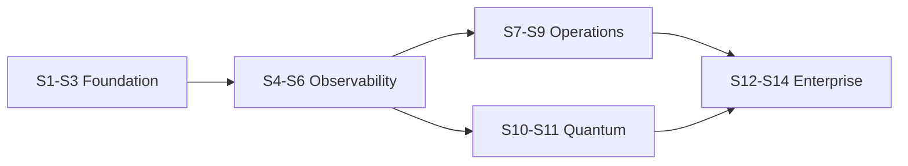

# Implementation roadmap — Releases A–E + sprints

**Date:** 2026-11-09  
Maps [ENTERPRISE_BENCHMARK_REPORT.md](ENTERPRISE_BENCHMARK_REPORT.md) to [../ENTERPRISE_MATURITY_PROGRAM.md](../ENTERPRISE_MATURITY_PROGRAM.md).

## Release overview

| Release | Theme | Priority band | Program sprints |
| --- | --- | --- | --- |
| **A** | Professional foundation | P0 | **S1–S3** (shipped lab) |
| **B** | Enterprise observability | P1 | **S4–S6** |
| **C** | Enterprise operations | P1 | **S7–S9** |
| **D** | Quantum intelligence | P2 | **S10–S11** |
| **E** | Advanced enterprise | P2–P3 | **S12–S14** |

---

## Release A — Professional foundation (P0) ✅ lab baseline

| Work item | Status | Evidence |
| --- | --- | --- |
| Design tokens + error/loading patterns | PARTIAL | tokens, Skeleton, route audit |
| Command palette (nav) | PARTIAL | `CommandPalette.jsx` |
| Request IDs + API errors | PASS | middleware + UI |
| Security hardening wave | PASS (lab) | SPRINT3_SECURITY |
| Playwright E01–E24 + gate script | PASS (lab) | E2E evidence, `run-e2e-telescope.sh` |
| Vitest unit infra | PASS | `npm test` |
| Prod env template | PASS | `.env.production.example` |

**Exit:** Checklist ≥33 PASS; QT-06 documented for go-live.

---

## Release B — Enterprise observability (P1)

### Shipped on `main` (2026-11-09 — do not rebuild)

| Item | Evidence |
| --- | --- |
| Collector execution history + quality JSONL | `82f3fd1`, B07 PASS, [SPRINT4_OBSERVABILITY.md](../QA/SPRINT4_OBSERVABILITY.md) |
| Audit log search (not unified app logs) | `/app/admin/logs`, E25 |
| Command palette entity search (partial) | Backends, alerts, incidents |
| Metrics Explorer v1 | `795ab5b`, [SPRINT4_METRICS_EXPLORER.md](../QA/SPRINT4_METRICS_EXPLORER.md) |
| Resource catalogue v1 | `336b956`, [SPRINT5_RESOURCE_CATALOG.md](../QA/SPRINT5_RESOURCE_CATALOG.md) |

### B-S4 remainder (Prompt 1)

- Unified **Logs Explorer** (structured app logs + audit; request_id).
- **Extend** collector execution API (30d, filters, richer fields) — JSONL exists.
- **Extend** ingestion quality schema — v1 heuristic exists.
- **Alert → log** links; quality tiles on Platform Health / backend.

### B-S5 remainder (Prompt 2)

- **Dependency map** v1 (collector → backend → alerts).
- Server-backed **saved metric queries**; registry-driven metrics.
- Roll **EnterpriseDataTable** (jobs, alerts, calibration, incidents per route audit).

**Sprint S6 (weeks 7–8)** — Reliability analytics

- **SLO definitions** + error budget chart (collector + API SLIs).
- **OpenTelemetry** traces for API + one collector path.
- **Synthetic probes** worker (health, auth, provider metadata).
- Visual regression + 9-viewport screenshot matrix (T05/T06).

**Release B acceptance:** [ACCEPTANCE_CRITERIA.md](ACCEPTANCE_CRITERIA.md) §B.

---

## Release C — Enterprise operations (P1)

**Sprint S7** — Alerting & notifications

- **Composite alert rules** (boolean DSL).
- **Notification centre** + routing (SMTP + webhook v1).
- Alert → log/metric drill-down links.

**Sprint S8** — Incidents & on-call

- Escalation policies, quiet hours, dedupe.
- Incident timeline + comms log + postmortem template.
- Shift handover page.

**Sprint S9** — Change & policy

- Configuration change history (admin deltas).
- Maintenance windows suppress correlation.
- **Policy engine** v1 (calibration freshness inheritance).
- Backup restore drill → QA evidence.

**Release C acceptance:** §C.

---

## Release D — Quantum intelligence (P2)

**Sprint S10**

- Calibration **revision diff** UI.
- Instruction/gate metric panels where data exists.
- Readiness **scorecard** per backend.

**Sprint S11**

- Benchmarking module (modality-gated).
- Workload–calibration reconstruction in replay.
- Facility correlation hardening.

**Release D acceptance:** §D.

---

## Release E — Advanced (P2–P3)

**Sprint S12–S14**

- Multi-facility RBAC.
- Integration developer centre.
- Workbooks / dashboard builder v2.
- Predictive analytics (only after D maturity).
- UAT sign-off package.

---

## Dependency graph (simplified)

## Anti-patterns (do not do)

- Add 20 pages before collector run history exists.  
- Ship SLO UI without SLI measurement jobs.  
- Copy CloudWatch pricing/scale assumptions.
